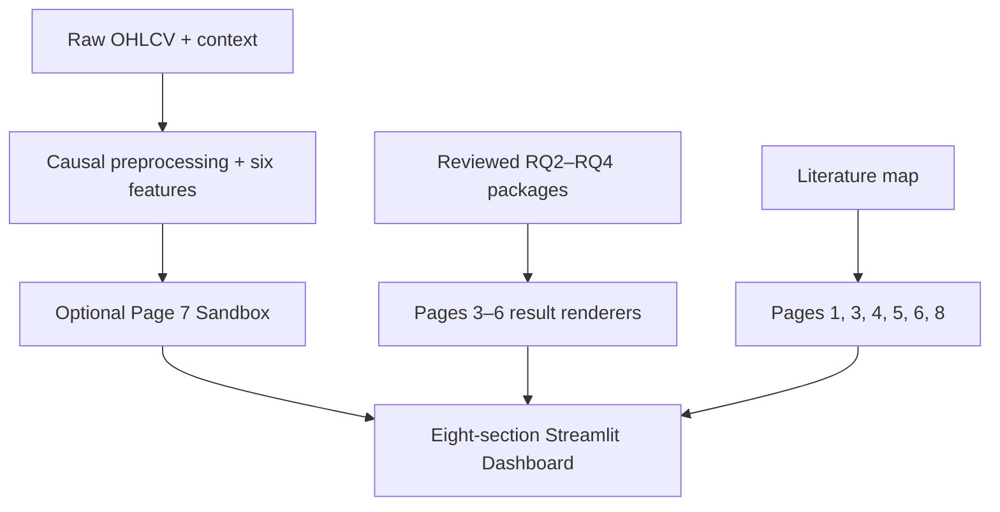

# Current Architecture

The project has one Streamlit entry point and two deliberately separated result
paths.

## Main components

| Component | Responsibility |
|---|---|
| `app.py` | Page configuration, navigation, Page 1/2/7/8, CSV input, optional Sandbox |
| `src/v8_sections.py` | Reviewed RQ2, RQ3, cross-asset, and RQ4 pages |
| `src/literature.py` | Feature and method rationale plus reference traceability |
| `src/data.py`, `src/context.py`, `src/features.py` | Causal data cleaning and feature construction |
| `src/ml.py`, `src/lstm.py` | Explicitly requested exploratory model training |
| `src/v8_evidence.py` | Read-only loaders for reviewed research outputs |
| `src/v8_sandbox.py` | Five-session exploratory decision layer |
| `research/rq2/`, `research/rq3/`, `research/rq4/` | Protocols, data snapshots, predictions, ledgers, outputs, and validators |

## Training boundary

Pages 1–6 and 8 do not train a formal model. Pages 3–6 render reviewed saved
outputs. Page 7 can train an exploratory model only after the user clicks
**Run Sandbox Model**.

## Evidence boundary

- RQ2 determines the common six-feature Technical input.
- RQ3 compares LR, RF, XGBoost, and Compact LSTM with identical information.
- The cross-asset page applies the same protocol with independent fitting for
  TSLA, AAPL, and NVDA.
- RQ4 converts the saved prediction streams into a common five-session
  decision layer.
- RQ4 returns never revise the RQ2 feature choice or RQ3 selection.

The root `release_manifest.json` hashes the delivered package. The three formal
research packages also retain their own protocols and integrity records.
