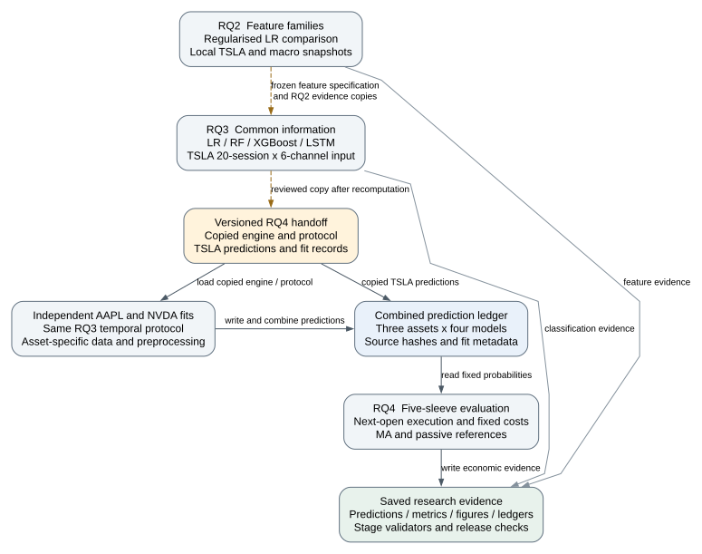
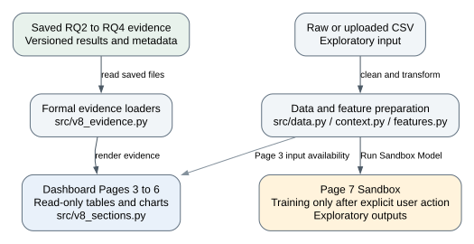

# LSTM epoch correction and research handoff

Base revision: `90b254bfde47dfeb98153bbc1a45375a2830bd1a`.

## Current status

The formal RQ3 source now records the one-based epoch whose weights Keras
EarlyStopping restores. Eight focused callback regression tests pass with
TensorFlow CPU 2.21.0 and Keras 3.15.1. The original implementation fails the
warm-up and min_delta regression cases. These tests exercise the real Keras
callback through a lightweight model double; they do not retrain the stock
models or validate their performance.

The existing numerical outputs, notebooks, manifests and RQ4 upstream copies
are unchanged historical evidence. A complete RQ3 and cross-asset rerun is
still required. Do not describe this branch as a corrected results release,
and do not rebuild manifests merely to make unchanged results appear current.

## Why the correction is needed

`fit_lstm_inner` restores weights using
`EarlyStopping(start_from_epoch=5, min_delta=1e-4, patience=10)` but previously
recorded `argmin(all_val_loss) + 1` for the subsequent fixed-epoch refit.
That minimum can occur during the first five unmonitored epochs, or can be a
decrease smaller than `min_delta` that never replaced the callback's best
weights. Thus validation scoring and refit duration could refer to different
epochs.

The correction sets `mode="min"` explicitly and reads
`callback.best_epoch + 1`. It rejects absent, unmonitored or nonfinite best
epochs instead of silently using epoch one. It retains the existing data,
architecture, search candidates, seeds, class weights, threshold and
early-stopping patience. Keras is not separately pinned by the existing
requirements; record its resolved version with future run metadata.

## Focused validation

Run from the repository root in a TensorFlow-enabled environment:

```bash
python -m pytest tests/test_rq3_lstm_epoch_selection.py -q -rA
```

The eight cases cover a lower warm-up loss, a decrease below min_delta,
normal completion at 100 epochs with restoration of epoch 95, an accepted
improvement, a patience stop, a missing validation monitor, no monitored
epoch and a nonfinite first monitored loss. The valid cases check both the
returned epoch and the prediction derived from the restored weights.

Test environment: Python 3.12.14, TensorFlow CPU 2.21.0, Keras 3.15.1,
pytest 9.1.1, NumPy 2.3.5, pandas 2.2.3, scikit-learn 1.8.0.
This is a callback-validation environment, not an exact recreation of the
formal requirements (which pin NumPy 2.5.1 and, for RQ3, pandas 3.0.5).

## Architecture



Solid arrows are execution-time reads or writes. Dashed arrows are explicit
versioned copies between stages. RQ3 reads its own local TSLA snapshot; the
cross-asset runner reads local AAPL/NVDA snapshots; RQ4 also reads local
execution-price snapshots. Those inputs are summarised in the stage labels
and this caption rather than drawn as crossing connections.



Formal performance results load saved evidence; Page 3 additionally displays
current-input availability metadata. Page 7 has no write path to the formal
result store. The separate graphs show implementation boundaries,
not newly completed experiments. DOT sources are editable; SVG exports are
vector figures suitable for the manuscript.

## Required rerun order

Perform the following in a dedicated corrected research checkout. Preserve
the original release for comparison. RQ2 does not need to rerun for this
isolated LSTM bookkeeping correction.

1. Run the focused tests, then regenerate RQ3 with its declared environment:

   ```bash
   python scripts/reproduce_all.py --stage rq3 --install
   ```

2. Review the regenerated inner epochs, outer/final LSTM predictions,
   one-standard-error selection, uncertainty tables and freeze outputs.
   Regenerate descriptive text and notebook cells that contain old results.
   Review outputs even if a validator returns successfully.

3. Explicitly copy the corrected RQ3 artefacts into the RQ4 handoff:

   | RQ3 source | RQ4 destination |
   | --- | --- |
   | `run_rq3_experiment.py` | `upstream/rq3_engine.py` |
   | `protocol.json` | `upstream/rq3_protocol.json` |
   | `outputs/rq3_all_predictions.csv` | `upstream/TSLA_rq3_all_predictions.csv` |
   | `outputs/rq3_fold_metrics.csv` | `upstream/TSLA_rq3_fold_metrics.csv` |
   | `outputs/rq3_selected_configurations.csv` | `upstream/TSLA_rq3_selected_configurations.csv` |

   Record the new SHA-256 values in RQ4's
   `protocol.json` / `upstream_prediction_protocol` for the engine, RQ3
   protocol and TSLA predictions. Only update hashes for artefacts that were
   actually regenerated and reviewed. Preserve unchanged data hashes.

4. Refit AAPL and NVDA using the corrected copied engine, combine their
   predictions with corrected TSLA evidence, then regenerate RQ4:

   ```bash
   python scripts/reproduce_all.py --stage rq4-cross-asset --install
   ```

   The standard `rq4` stage uses existing predictions. The `all` stage runs
   RQ2, RQ3 and standard RQ4; it neither synchronises the handoff nor includes
   cross-asset refitting. It is insufficient by itself for this correction.

5. Inspect every affected figure, notebook and manuscript table. Re-run
   stage and integrated checks, then rebuild the release manifest only after
   the corrected package is complete. The source hash failure in the current
   branch is expected and must not be suppressed. Dashboard views should
   present corrected results only after the evidence files are replaced.

RQ4 consumes `upstream/rq4_model_predictions.csv`, the three-asset,
four-model ledger. The selected-only RQ3 signal is not its sole input.
RQ4 returns must not be used to change the model choice or threshold.

## Source references

- Keras callback: <https://keras.io/api/callbacks/early_stopping/>
- Verified installed implementation: `keras/src/callbacks/early_stopping.py`
  in Keras 3.15.1; `best_epoch` is zero-based, restored at `on_train_end`.
- Formal runners: `research/rq2/run_rq2_experiment.py`,
  `research/rq3/run_rq3_experiment.py`,
  `research/rq4/run_cross_asset_predictions.py`,
  `research/rq4/run_rq4_experiment.py`.
- Presentation loaders: `src/v8_evidence.py` and `src/v8_sections.py`.
